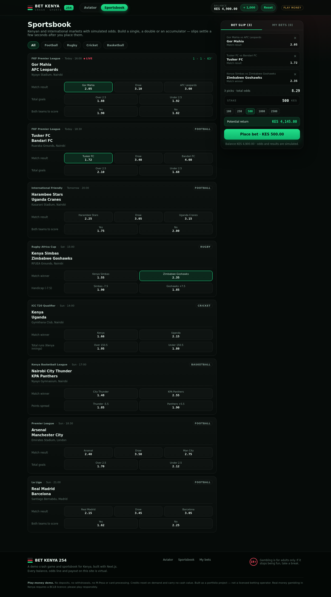

# Bet Kenya 254

A crash-game and sportsbook product built with Next.js: a lobby, an Aviator-style crash game, a Kenyan sportsbook, registered accounts with a wallet, and responsible-gambling controls.

> **Play-money preview.** No deposits, withdrawals or real wagers are processed. Balances are virtual. Accounts, wallets and bet history persist in Postgres (Neon). Running a real book also needs a BLCB licence, KYC/AML and payment rails — see [Making it real](#making-it-real).


| Aviator | Account | Sportsbook |
| --- | --- | --- |
|  |  |  |

Mobile: 

## Two sides

| | Demo | Account |
| --- | --- | --- |
| Sign-up | None | Email, phone, date of birth (18+) |
| Wallet | KES 5,000 virtual credits, resettable | Own balance, ledger, deposits & withdrawal requests |
| Persistence | Server-side (guest session) | Server-side (email + password) |
| Limits / self-exclusion | Global demo limits | Per-account limits, reality checks, self-exclusion |
| Withdrawals | — | Requires KYC verification |

Switch wallets with the **Demo / Account** toggle in the header. Both wallets keep their own balance, bet history and ledger.

## What's built

**Lobby (`/`)** — hero, product stats, game catalogue, live demo activity feed, trust/USP panel.

**Aviator (`/aviator`)**
- 7s betting window → flight → bust hold → next round, driven by one `requestAnimationFrame` loop.
- Canvas chart with gradient fill, glow curve, whole-second ticks, head marker; multiplier goes green → gold → red.
- Stake chips, auto cash-out with target, cancel before takeoff, queue a bet for the next round mid-flight.
- Live simulated player table, recent-bust strip, commit/reveal fairness card, personal bet history.

**Sportsbook (`/sports`)**
- 8 fixtures across FKF Premier League, international football, rugby, cricket, basketball, EPL and La Liga.
- Markets: 1X2, totals, BTTS, handicap, spread; singles or accumulators with live odds multiplication.
- Bet slip with stake chips and potential return; "My bets" resolves tickets after ~14 seconds.

**Account (`/account`)**
- Overview: balance, today's staked/net, lifetime totals, recent ledger.
- Wallet: simulated M-Pesa / card / Airtel deposits, withdrawal requests, full ledger.
- Limits & safety: daily deposit limit, daily loss limit, reality-check interval, 1/7/30-day self-exclusion.
- Verification: KYC submission with reference and simulated approval (withdrawals stay locked until verified).
- Security: password change, 2FA toggle, session info, demo tools.

**Auth (`/auth`)** — sign-in and registration with inline validation. Passwords are hashed server-side with scrypt (`scrypt:N:r:p` string, 64-byte derived key, per-user salt) and sessions are HTTP-only cookies backed by a `sessions` table.

**Provably fair (`/fair`)** — recompute any round from a seed: commitment hash, bust point, flight duration, and the exact hash input.

## Game math

```
crash = 0.99 / (1 − u)          u = hash(seed + ":" + round) / 2³²
multiplier(t) = e^(0.07 · t)    t in seconds
```

Resulting profile: ~1% instant busts at 1.00x, ~34% below 1.5x, ~50% below 2.00x, capped at 5,000x. The 0.99 factor is the 1% house edge.

## Data layer

Everything money-related lives in Postgres (Neon serverless, pooled connection).

```
users ──< sessions
  │
  ├──< wallets (user_id, mode: demo|account) ──< transactions
  │        ├──< aviator_bets
  │        └──< tickets ──< ticket_legs
  ├──< withdrawals
  └── limits (daily deposit, daily loss, reality check)
```

- Every balance change runs inside a `begin … commit` transaction with `select … for update` on the wallet row, so concurrent tabs can't double-spend.
- Guests get a real row + demo wallet on first request; registering upgrades that guest in place, keeping the demo balance and adding an account wallet.
- Server-side guards: stake bounds, daily loss limit, self-exclusion, KYC-before-withdrawal, daily deposit limit, minimum slip age before settlement.
- API: `GET /api/bootstrap`, `POST /api/auth`, `/api/wallet`, `/api/aviator`, `/api/sports`, `/api/account` — all return the fresh snapshot so the UI never drifts.

## Structure

```
app/
  page.tsx             lobby
  aviator/page.tsx     crash game
  sports/page.tsx      sportsbook
  account/page.tsx     wallet, limits, KYC, security
  auth/page.tsx        sign in / register
  fair/page.tsx        fairness verifier
  globals.css          design system
components/
  AviatorGame.tsx      round UI, betting, history
  CrashCanvas.tsx      canvas renderer
  LiveBets.tsx         simulated players
  FairnessCard.tsx     commit/reveal panel
  SportsPage.tsx       markets, slip, settlement
  AccountPanels.tsx    account tabs
  AuthPanel.tsx        auth forms
  LobbyTicker.tsx      live activity
  SiteHeader/Footer    shell
lib/
  bank.tsx             auth + wallets + limits + ledger (single provider)
  game.ts              crash math, formatting, seeded RNG
  useAviator.ts        round state machine
  sports.ts            fixtures and odds
lib/server/
  db.ts                pg pool + transaction helper
  schema.sql           full schema
  store.ts             snapshot, auth, wallet and bet logic
  session.ts           cookie sessions
  passwords.ts         scrypt hashing
app/api/*/route.ts     JSON endpoints
scripts/migrate.mjs    applies schema.sql to DATABASE_URL
```

## Run

```bash
npm install
echo 'DATABASE_URL=postgres://…' > .env.local
npm run db:migrate      # creates the schema
npm run dev             # http://localhost:3000
```

Node 18.18+; built on Node 22 with Next 15 / React 19.

## Making it real

The app is shaped like a production book but stops short of money movement. To take it live:

1. ~~Database~~ — done: users, sessions, wallets, ledger, bets and withdrawals all live in Postgres.
2. **Server-side RNG** — generate and store the crash seed on the server, expose the hash before the round, reveal after. The engine still runs in the browser, so the client decides the bust point — acceptable for a demo, not for money.
3. **Payments** — integrate an M-Pesa Daraja / card provider behind the deposit and withdrawal endpoints, with idempotency keys and reconciliation.
4. **Compliance** — BCLB licence, KYC document checks, AML monitoring, tax reporting, complaints and self-exclusion shared across operators.
5. **Ops** — rate limiting, audit logs, monitoring, incident runbooks, responsible-gambling helpline links.

18+. If gambling stops being fun, stop.
