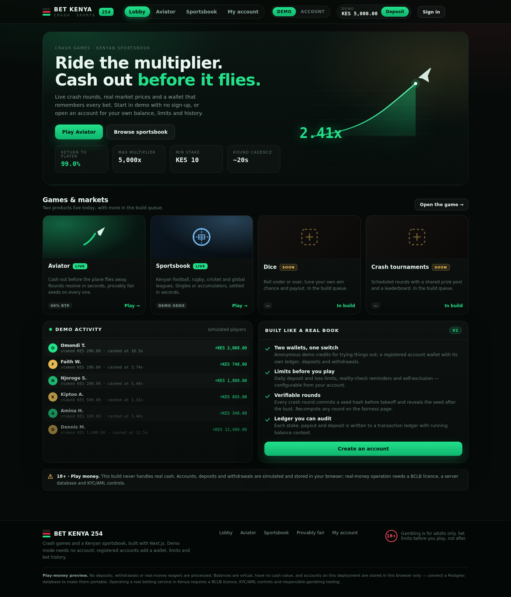
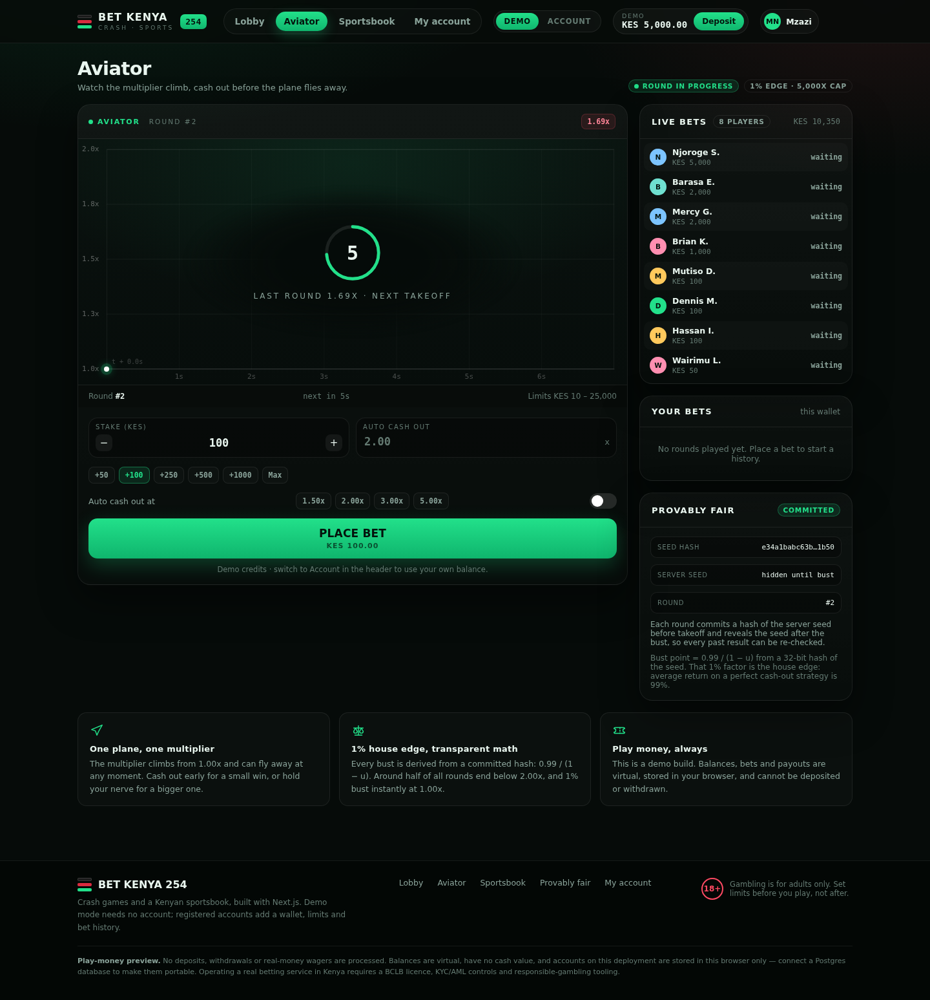
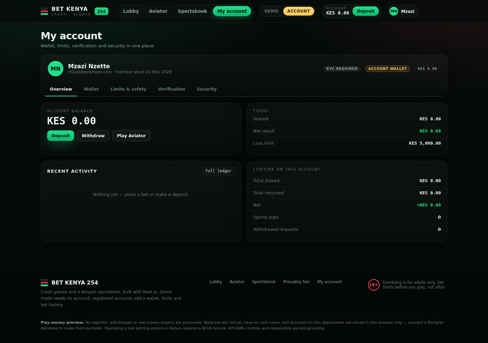

# Bet Kenya 254

A crash-game and sportsbook product built with Next.js: a lobby, an Aviator-style crash game, a Kenyan sportsbook, registered accounts with a wallet, and responsible-gambling controls.

> **Play-money preview.** No deposits, withdrawals or real wagers are processed. Balances are virtual and accounts live in this browser. Running a real book needs a BLCB licence, KYC/AML and a server database — see [Making it real](#making-it-real).



| Aviator | Account | Sportsbook |
| --- | --- | --- |
|  |  |  |

Mobile: 

## Two sides

| | Demo | Account |
| --- | --- | --- |
| Sign-up | None | Email, phone, date of birth (18+) |
| Wallet | KES 5,000 virtual credits, resettable | Own balance, ledger, deposits & withdrawal requests |
| Persistence | Per browser | Per browser (until a database is attached) |
| Limits / self-exclusion | Global demo limits | Per-account limits, reality checks, self-exclusion |
| Withdrawals | — | Requires KYC verification |

Switch wallets with the **Demo / Account** toggle in the header. Both wallets keep their own balance, bet history and ledger.

## What's built

**Lobby (`/`)** — hero, product stats, game catalogue, live demo activity feed, trust/USP panel.

**Aviator (`/aviator`)**
- 7s betting window → flight → bust hold → next round, driven by one `requestAnimationFrame` loop.
- Canvas chart with gradient fill, glow curve, whole-second ticks, head marker; multiplier goes green → gold → red.
- Stake chips, auto cash-out with target, cancel before takeoff, queue a bet for the next round mid-flight.
- Live simulated player table, recent-bust strip, commit/reveal fairness card, personal bet history.

**Sportsbook (`/sports`)**
- 8 fixtures across FKF Premier League, international football, rugby, cricket, basketball, EPL and La Liga.
- Markets: 1X2, totals, BTTS, handicap, spread; singles or accumulators with live odds multiplication.
- Bet slip with stake chips and potential return; "My bets" resolves tickets after ~14 seconds.

**Account (`/account`)**
- Overview: balance, today's staked/net, lifetime totals, recent ledger.
- Wallet: simulated M-Pesa / card / Airtel deposits, withdrawal requests, full ledger.
- Limits & safety: daily deposit limit, daily loss limit, reality-check interval, 1/7/30-day self-exclusion.
- Verification: KYC submission with reference and simulated approval (withdrawals stay locked until verified).
- Security: password change, 2FA toggle, session info, demo tools.

**Auth (`/auth`)** — sign-in and registration with inline validation; passwords are hashed with PBKDF2-SHA256 (150k iterations, per-user salt) via WebCrypto before storage.

**Provably fair (`/fair`)** — recompute any round from a seed: commitment hash, bust point, flight duration, and the exact hash input.

## Game math

```
crash = 0.99 / (1 − u)          u = hash(seed + ":" + round) / 2³²
multiplier(t) = e^(0.07 · t)    t in seconds
```

Resulting profile: ~1% instant busts at 1.00x, ~34% below 1.5x, ~50% below 2.00x, capped at 5,000x. The 0.99 factor is the 1% house edge.

## Structure

```
app/
  page.tsx             lobby
  aviator/page.tsx     crash game
  sports/page.tsx      sportsbook
  account/page.tsx     wallet, limits, KYC, security
  auth/page.tsx        sign in / register
  fair/page.tsx        fairness verifier
  globals.css          design system
components/
  AviatorGame.tsx      round UI, betting, history
  CrashCanvas.tsx      canvas renderer
  LiveBets.tsx         simulated players
  FairnessCard.tsx     commit/reveal panel
  SportsPage.tsx       markets, slip, settlement
  AccountPanels.tsx    account tabs
  AuthPanel.tsx        auth forms
  LobbyTicker.tsx      live activity
  SiteHeader/Footer    shell
lib/
  bank.tsx             auth + wallets + limits + ledger (single provider)
  game.ts              crash math, formatting, seeded RNG
  useAviator.ts        round state machine
  sports.ts            fixtures and odds
```

## Run

```bash
npm install
npm run dev      # http://localhost:3000
npm run build && npm start
```

Node 18.18+; built on Node 22 with Next 15 / React 19.

## Making it real

The app is shaped like a production book but stops short of money movement. To take it live:

1. **Database** — move `lib/bank.tsx` state into Postgres (users, sessions, wallets, ledger, bets). The provider's API is already the seam: swap its internals for API routes.
2. **Server-side RNG** — generate and store the crash seed server-side, expose the hash before the round, reveal after. Today it runs in the browser, which is fine for a demo but not for money.
3. **Payments** — integrate an M-Pesa Daraja / card provider behind the deposit and withdrawal endpoints, with idempotency keys and reconciliation.
4. **Compliance** — BCLB licence, KYC document checks, AML monitoring, tax reporting, complaints and self-exclusion shared across operators.
5. **Ops** — rate limiting, audit logs, monitoring, incident runbooks, responsible-gambling helpline links.

18+. If gambling stops being fun, stop.
