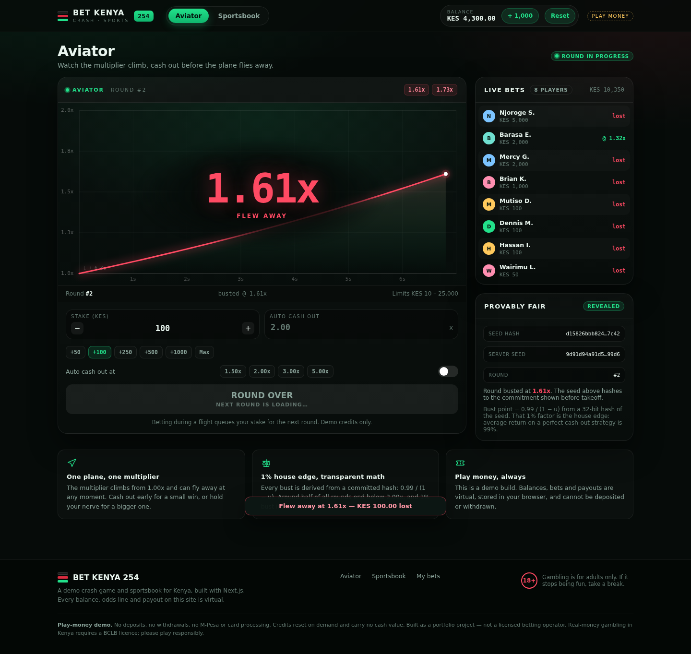
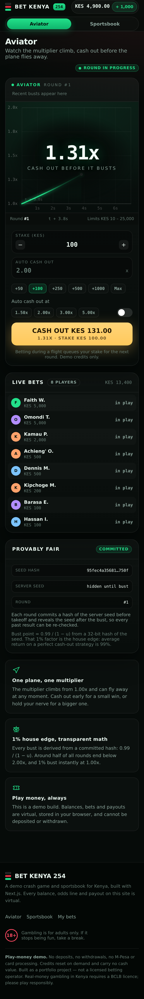

# Bet Kenya 254

A single Next.js site with an **Aviator-style crash game** and a **Kenyan sportsbook**, sharing one demo wallet.

> Play-money demo. No deposits, withdrawals, M-Pesa, or card processing. Balances live in `localStorage`, carry no cash value, and are reset from the header. This is not a licensed betting operator.


## Run it

```bash
npm install
npm run dev      # http://localhost:3000
npm run build && npm start
```

Requires Node 18.18+ (built and tested on Node 22 with Next 15 / React 19).

## Screens

| Aviator | Busted | Sportsbook |
| --- | --- | --- |
|  |  |  |

Mobile: 

## What's inside

**Aviator (`/`)**
- Round lifecycle driven by one `requestAnimationFrame` loop: 7s betting window → flight → 3.2s bust hold → next round.
- Canvas chart with gradient fill, glow curve, grid, axis labels and a moving head marker. Multiplier display changes colour as it climbs and turns red on bust.
- Stake controls, quick chips, auto cash-out (toggle + target), cancel-before-takeoff, queue-a-bet-for-next-round while flying.
- Live bets table of simulated players, recent-bust history strip.
- Provably-fair style commit/reveal: a seed hash is shown before takeoff, the seed is revealed only after the bust.

**Sportsbook (`/sports`)**
- Filterable markets (FKF Premier League, Harambee Stars, Rugby Africa Cup, cricket, basketball, EPL, La Liga) with 1X2, totals, BTTS, handicap and spread lines.
- Bet slip with single/multiple selections, accumulator odds, stake chips, potential return.
- My bets tab with open/won/lost tickets; slips settle against simulated results after ~14s.
- One shared wallet with the crash game (`lib/wallet.tsx`), persisted per browser.

## Game math

`lib/game.ts`

```
crash = 0.99 / (1 - u)          u = hash(seed + ":" + round) / 2^32
multiplier(t) = e^(0.07 * t)    t in seconds
```

That gives the familiar crash profile: ~1% instant busts at 1.00x, ~34% below 1.5x, ~50% below 2.00x, and a long tail capped at 5,000x. The 0.99 factor is the 1% house edge.

The hash is FNV-1a based and runs in the browser — good enough to demonstrate commit/reveal, not a substitute for server-side RNG if this were ever played for money.

## Structure

```
app/
  layout.tsx        shell, header, footer, wallet provider
  page.tsx          aviator screen
  sports/page.tsx   sportsbook screen
  globals.css       design system + components
components/
  AviatorGame.tsx   round UI, betting state, toasts
  CrashCanvas.tsx   canvas chart renderer
  LiveBets.tsx      simulated players
  FairnessCard.tsx  commit/reveal panel
  SportsPage.tsx    markets, bet slip, ticket settlement
  SiteHeader/Footer, ToastStack
lib/
  game.ts           crash math, formatting, seeded RNG
  useAviator.ts     round state machine
  sports.ts         mock fixtures and odds
  wallet.tsx        balance, transactions, bet slips
```

## Notes

- All odds, fixtures and results are fictional sample data.
- If you ever take this toward real money: move the RNG server-side behind an authenticated API, add a licensed operator, KYC/AML, deposit limits and self-exclusion tooling (BCLB in Kenya), and never trust client-side balances.
- 18+. If gambling stops being fun, take a break.
